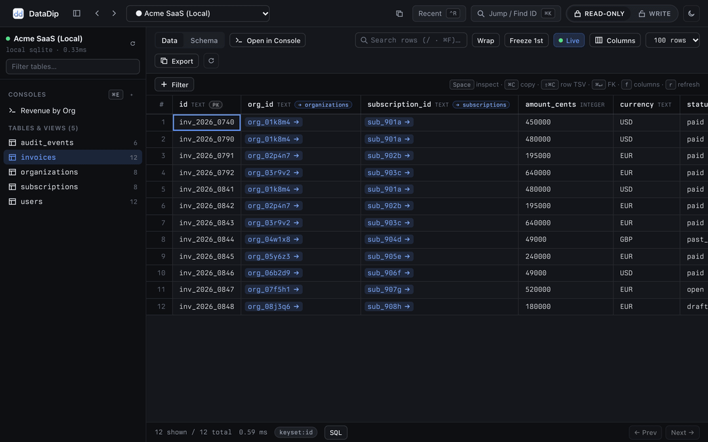
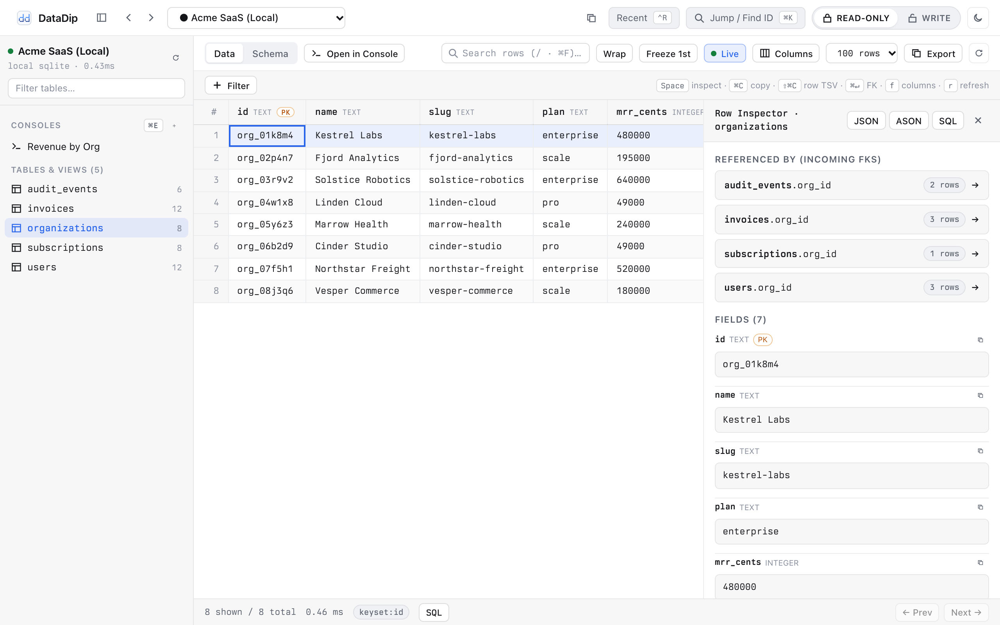
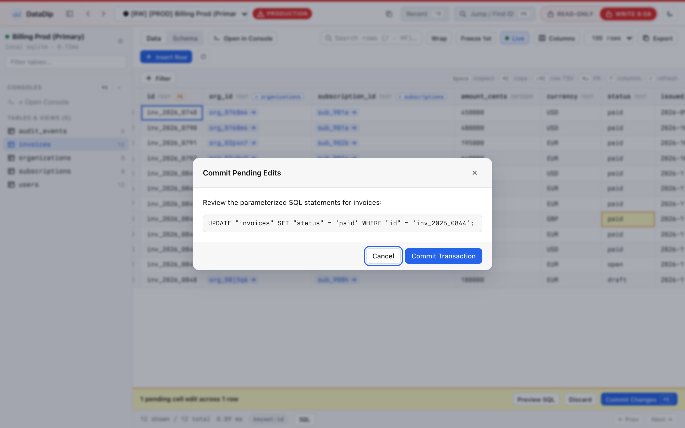

# DataDip

A fast, keyboard-first **SQLite & PostgreSQL** browser, foreign-key navigator, and SQL console for local databases and remote servers over SSH.

Click foreign keys to jump between related rows, use normal Back/Forward (`Cmd+[` / `Cmd+]`, trackpad swipe) to return without losing your filters, and paste any ID into `Cmd+K` to find matching rows across tables. Read-only by default. No Electron.



<details>
<summary>More screenshots (Row Inspector, SQL Console, Production Safety, Omnibar ID Search)</summary>

| Row Inspector & Reverse FKs | SQL Console with Clickable FKs |
|---|---|
|  |  |

| Production Safety & Staged SQL Preview | Omnibar Cross-Table ID Search (`Cmd+K`) |
|---|---|
|  |  |

</details>

## Supported Engines & Platforms

| Engine / Transport | Status | Notes |
|---|---|---|
| **SQLite (local)** | Supported | Opens read-only by default (`bun:sqlite`); `datadip ./app.db` opens files directly |
| **SQLite over SSH** | Supported | Reuses one persistent SSH session per host; requires `bun` on the remote host |
| **PostgreSQL (direct TCP/TLS)** | Supported | Native `Bun.SQL`; paste any `DATABASE_URL` (`postgres://...`), enforces `BEGIN READ ONLY` in Read-Only mode |
| **PostgreSQL over SSH tunnel** | Supported | Local OpenSSH port forwarding (`ssh -N -L`) with `~/.ssh/config` & `ProxyJump`; **no remote Bun needed** |
| **macOS & Browser** | Supported | Web UI runs in any browser; optional lightweight macOS `DataDip.app` (`WKWebView` shell, no Electron) |

## Features

- **Navigate relationships like the web**: Click foreign-key cells to jump across tables, hover any FK cell to preview the target row, press `Space` to inspect a row's formatted JSON, outgoing FKs, and incoming ("Referenced by") counts, and hit Back/Forward to return to your exact filtered view.
- **Read-only defaults and write safeguards**: Every connection starts Read-Only (enforced at the SQLite handle / PostgreSQL `READ ONLY` transaction layer and in server validation). Connections marked Production show a persistent crimson header bar and auto-relock Read-Write after 10 minutes idle. Inline grid edits are staged with a SQL preview before committing, and destructive SQL (`DROP`, `ALTER`, `TRUNCATE`, or `DELETE`/`UPDATE` without `WHERE`) requires confirmation on every database.
- **Parallel, cancellable SQL Console (`Cmd+E` / `Cmd+Shift+L`)**: Tabbed and side-by-side split consoles with live schema autocomplete, SQL linting, formatting (`Cmd+Shift+F`), active-statement execution (`Cmd+Enter`), `EXPLAIN`, clickable foreign keys inside query results, and real cancellation (`Cmd+.` / Stop) on worker threads / PostgreSQL `CancelRequest`.
- **Interactive SSH authentication**: Honors `~/.ssh/config` aliases and `ProxyJump`, and prompts cleanly in-app for encrypted key passphrases, SSH passwords, 2FA codes, and unknown host-key fingerprints via `SSH_ASKPASS` (never logged or saved to disk).
- **Omnibar (`Cmd+K` / `Cmd+P`) & Recents (`Ctrl+R`)**: Jump to any table, column, console, or saved connection -- or paste an ID from a support ticket to locate matching rows across every table.
- **Full-result file exports**: Download table views or SQL query results to disk as CSV, TSV, JSON, Markdown, or SQL `INSERT` statements (not limited to the visible page).
- **Large-table friendly**: Uses keyset pagination and skips automatic full-table `COUNT(*)` scans on large databases (using `pg_class.reltuples` on Postgres and `sqlite_stat1` on large SQLite files).

## Install & Run (from source)

Prerequisites: macOS or Linux with `git` (and Xcode Command Line Tools / `swiftc` if you want the optional macOS `DataDip.app`).

> **What `./install` does:** installs [Bun](https://bun.sh) via `curl | bash` if not already installed, runs `bun install` and `bun run build`, symlinks `~/.local/bin/datadip`, adds `~/.local/bin` to your shell config if missing, and builds `~/Applications/DataDip.app` on macOS when `swiftc` is present.

```sh
git clone https://github.com/anttikissa/datadip.git
cd datadip
./install
```

Usage:

```sh
datadip               # start local server and open in browser
datadip ./app.db      # open a local SQLite file directly
datadip stop          # stop the background server
datadip serve         # run server in foreground (default 127.0.0.1:4747)
open -a DataDip       # launch the macOS WKWebView app
```

## Development

```sh
bun install
bun run serve         # API server on :4747
bun run dev           # Vite HMR client on :4748
./test                # typecheck + unit tests
./mac/build-dmg       # build self-contained signed macOS .app & .dmg (--notarize <profile> to notarize)
```

## License

[MIT](LICENSE)
