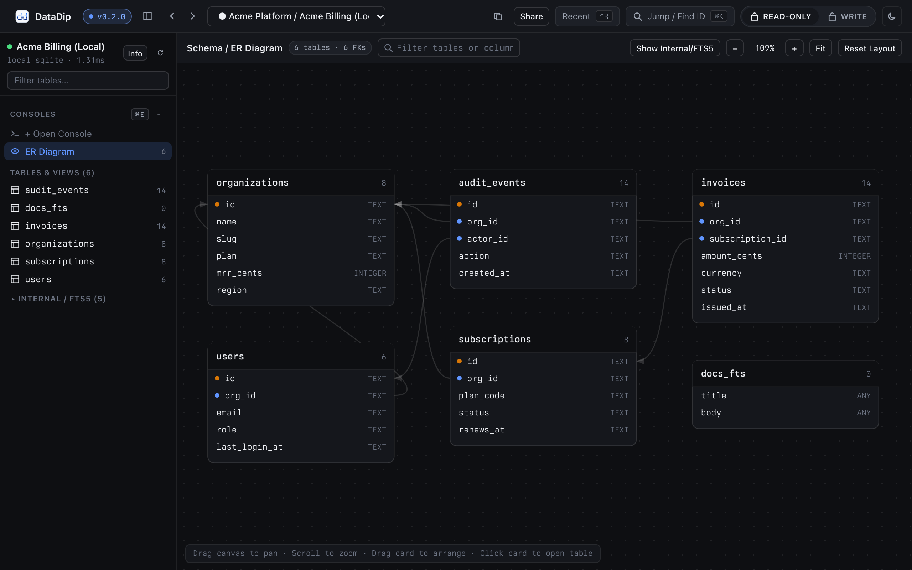
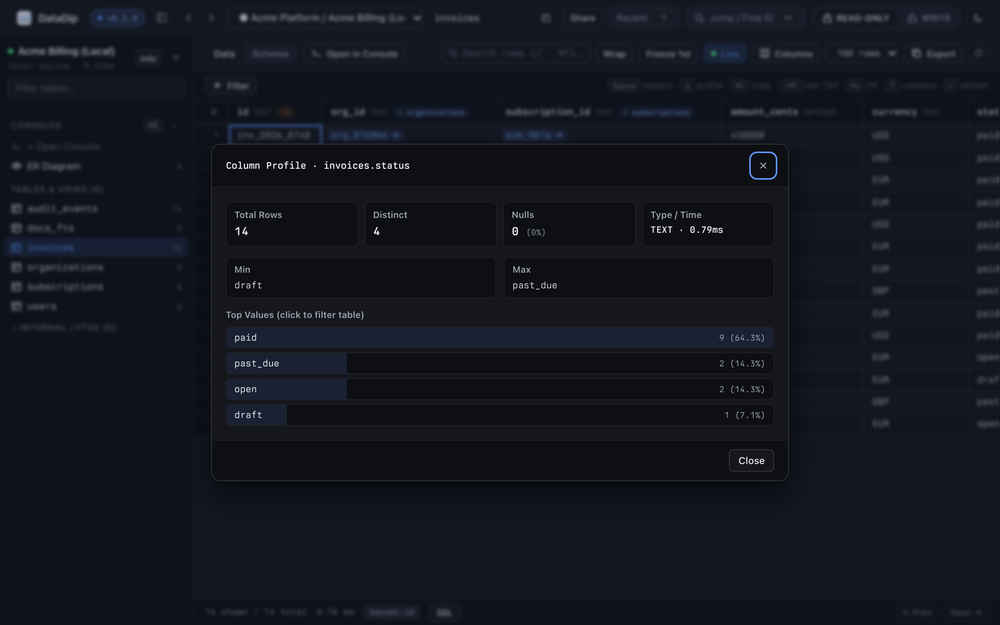
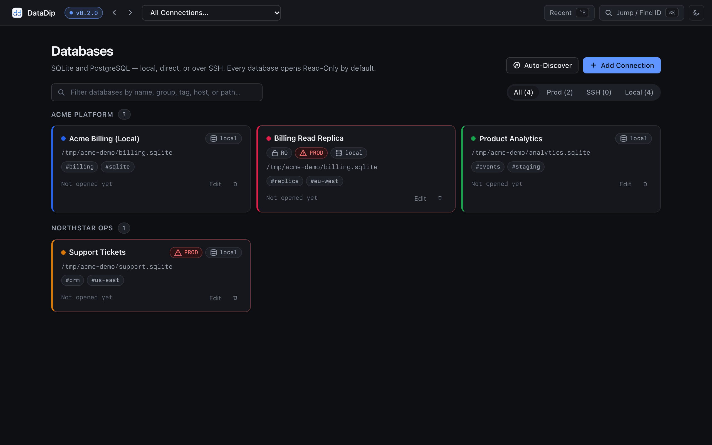
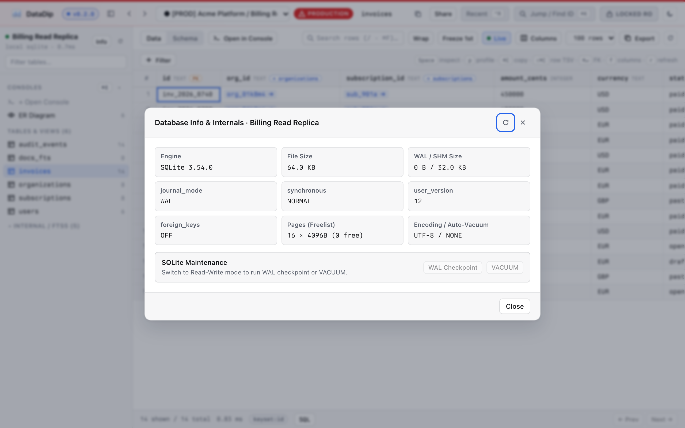
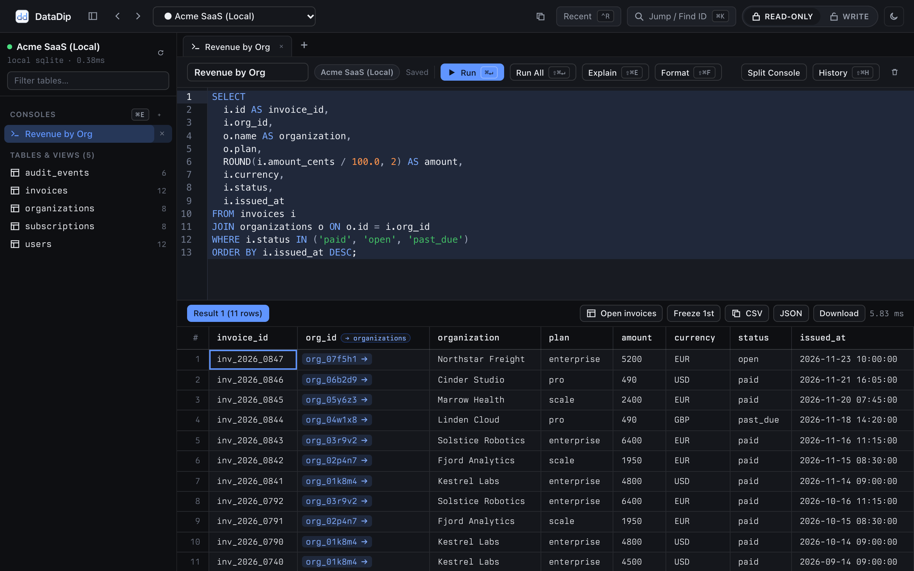
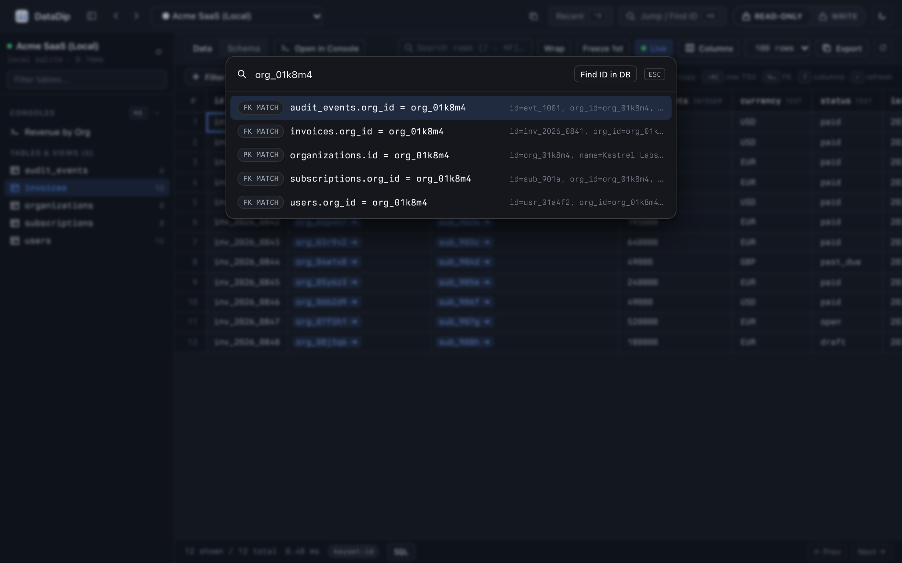

# DataDip

A fast, keyboard-first **SQLite & PostgreSQL** browser, foreign-key navigator, and SQL console for local databases and remote servers over SSH.

Click foreign keys to jump between related rows, use normal Back/Forward (`Cmd+[` / `Cmd+]`, trackpad swipe) to return without losing your filters, and paste any ID into `Cmd+K` to find matching rows across tables. Read-only by default. No Electron.


<details>
<summary>More screenshots (ER Diagram, Column Profiling, Workspaces, Row Inspector, SQL Console, Production Safety, Omnibar)</summary>

| Interactive Schema / ER Diagram | One-Keystroke Column Profiling (`p`) |
|---|---|
|  |  |

| Client Workspaces, Tags & Locked RO | SQLite PRAGMA / WAL Inspector |
|---|---|
|  |  |

| Row Inspector & Reverse FKs | SQL Console with Clickable FKs |
|---|---|
|  |  |

| Production Safety & Staged SQL Preview | Omnibar Cross-Table ID Search (`Cmd+K`) |
|---|---|
|  |  |

</details>

## Supported Engines & Platforms

| Engine / Transport | Status | Notes |
|---|---|---|
| **SQLite (local)** | Supported | Opens read-only by default (`bun:sqlite`); `datadip ./app.db` opens files directly |
| **SQLite over SSH** | Supported | One persistent SSH pipe per host auto-detecting `bun`, `python3` (stdlib `sqlite3`), or `sqlite3` CLI -- zero remote files, opt-in Bun install fallback |
| **Serverless SQLite (Turso / D1)** | Supported | Native zero-dependency HTTP adapters for Turso / libSQL (Hrana v2 atomic batches) and Cloudflare D1 REST API |
| **PostgreSQL (direct TCP/TLS)** | Supported | Native `Bun.SQL`; paste any `DATABASE_URL` (`postgres://...`), auto-TLS (`sslmode=prefer`), enforces `BEGIN READ ONLY` in Read-Only mode |
| **PostgreSQL over SSH tunnel** | Supported | Local OpenSSH port forwarding (`ssh -N -L`) with `~/.ssh/config` & `ProxyJump`; zero remote software needed |
| **macOS & Browser** | Supported | Web UI runs in any browser; optional lightweight macOS `DataDip.app` (`WKWebView` shell, no Electron) |

## Features

- **Navigate relationships like the web**: Click foreign-key cells (DB-declared, passively learned from ID signatures, or user-configured Virtual FKs) to jump across tables, hover any FK cell to preview the target row, press `Space` to inspect a row's formatted JSON, outgoing FKs, and incoming ("Referenced by") counts, visualize the full schema in the interactive **ER Diagram**, and hit Back/Forward to return to your exact filtered view.
- **Staged inline editing & production guardrails**: Every connection starts Read-Only (enforced at the SQLite handle / PostgreSQL `READ ONLY` transaction / Turso `PRAGMA query_only` layer and in server validation), and connections can be locked **permanently Read-Only** (`alwaysReadOnly`). Production connections show a persistent crimson bar, require typing the exact database name to arm writes, and auto-relock after 10 minutes idle or when switching databases. Inline cell edits, row duplicates, inserts, deletes, and CSV/JSON imports stage in amber with an exact SQL preview and commit atomically in a single transaction.
- **Parallel, cancellable SQL Console (`Cmd+E` / `Cmd+Shift+L`)**: Tabbed and side-by-side split consoles with live schema autocomplete, SQL linting, formatting (`Cmd+Shift+F`), active-statement execution (`Cmd+Enter`), `EXPLAIN`, clickable foreign keys inside query results, searchable cross-connection query history, and real cancellation (`Cmd+.` / Stop) on worker threads / Python `conn.interrupt()` / PostgreSQL `CancelRequest`.
- **Column profiling, workspaces, & teammate links**: Press `p` (or click `Σ` on any column header) for instant null %, distinct count, min/max, and clickable top-value filters. Organize connections into color-coded workspace folders & tags, share teammate-friendly slug links (`Share` button -> `/c/<db-name>/...`), and duplicate rows or import CSV/JSON in a single transaction.
- **Interactive SSH authentication & discovery**: Pick hosts from `~/.ssh/config` (honoring `ProxyJump`), answer encrypted key passphrases, SSH passwords, 2FA codes, and unknown host-key fingerprints in-app via `SSH_ASKPASS`, and auto-discover local, remote SSH, iOS Simulator, and macOS App Container SQLite databases.
- **SQLite internals & large-table safety**: Inspect triggers, collapse FTS5 shadow tables automatically, view PRAGMA / WAL sizes (`user_version`, freelist, checkpoint & `VACUUM`), browse large tables safely with keyset pagination and zero-scan row estimates, and export up to 100k rows as CSV, TSV, JSON, Markdown, or SQL `INSERT`.

## Download (macOS Apple Silicon)

Download the signed and Apple-notarized **`DataDip-0.4.0-arm64.dmg`** from [GitHub Releases](https://github.com/anttikissa/datadip/releases/latest) (macOS 13.3+, self-contained, no Bun or Xcode required).

1. Open the `.dmg` and drag **DataDip.app** into `/Applications`.
2. Double-click `.db` / `.sqlite` files in Finder, drop them on the Dock icon, or press `Cmd+O`.
3. Optionally choose **DataDip -> Install 'datadip' CLI...** from the menu bar to enable `datadip ./app.db` in your terminal.
4. Future updates install in-place via **DataDip -> Check for Updates...** (verified against Apple Developer ID).

```text
SHA-256 (DataDip-0.4.0-arm64.dmg):
7c14e703b5d3ce6bc0ede4d2aeea22791ed6ba82e0e4411defd03aad815da8b1
```

## Install & Run (from source)

Prerequisites: macOS or Linux with `git` (and Xcode Command Line Tools / `swiftc` if you want the optional macOS `DataDip.app`).

> **What `./install` does:** installs [Bun](https://bun.sh) via `curl | bash` if not already installed, runs `bun install` and `bun run build`, symlinks `~/.local/bin/datadip`, adds `~/.local/bin` to your shell config if missing, and builds `~/Applications/DataDip.app` on macOS when `swiftc` is present.

```sh
git clone https://github.com/anttikissa/datadip.git
cd datadip
./install
```

Usage:

```sh
datadip               # start local server and open in browser
datadip ./app.db      # open a local SQLite file directly
datadip stop          # stop the background server
datadip serve         # run server in foreground (default 127.0.0.1:4747)
open -a DataDip       # launch the macOS WKWebView app
```

## Development

```sh
bun install
bun run serve         # API server on :4747
bun run dev           # Vite HMR client on :4748
./test                # typecheck + unit tests
./mac/build-dmg       # build self-contained signed macOS .app & .dmg (--notarize <profile> to notarize)
```

## Changelog & License

- Release history: [CHANGELOG.md](CHANGELOG.md) (also available in-app via the top-bar version pill or `Cmd+K` -> *What's New*)
- License: [MIT](LICENSE)
